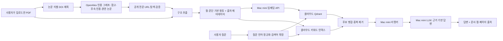

# RAG 확장 설계

상태: **설계안**. 현재 코드는 업로드 논문의 3문장 묶음, OpenAlex의 참고·관련·후속 인용·최근 3년 논문 초록, Wikipedia 설명을 TF-IDF로 검색한다. 최근 논문은 키워드 검색 후 날짜와 핵심 단어 일치로 거르며, 깊은 의미 기반 관련성 검증은 아직 없다. 아래의 공개 전문 수집, 구조 기반 청킹, 임베딩, 벡터 DB, 하이브리드 검색, 리랭킹은 아직 구현·검증하지 않았다.

## 데이터 흐름

## 1. 논문 식별과 외부 자료 수집

- 업로드 PDF에서 DOI를 우선 추출한다. DOI가 없으면 제목을 추출해 OpenAlex에서 찾되, 제목 유사도·저자·연도를 검증해 잘못된 논문에 연결하지 않는다.
- OpenAlex의 `referenced_works`, `cites`, `related_works`로 1단계 인용 그래프를 만든다. 첫 실험은 참고 5편, 후속 인용 5편, 관련 5편을 상한으로 두고, 제목·초록과 업로드 논문의 유사도로 후보를 재정렬한다. DOI/OpenAlex ID로 중복을 제거한다.
- 각 후보의 공개 초록과 공개 접근 가능한 전문 위치(`best_oa_location` 등)를 확인한다. arXiv처럼 공개 PDF가 있는 자료는 라이선스·접근 조건을 확인한 뒤 다운로드해 추출한다. 유료·비공개 전문은 우회하지 않는다. 전문을 얻지 못한 자료는 **초록만** 인덱싱하고 화면에도 초록 근거임을 표시한다.
- 제목·DOI·초록·본문을 가져온 URL, OpenAlex ID, DOI, 연도, 저자, 자료 유형, 공개 전문/초록 구분, 수집 시각을 저장한다. PDF 다운로드는 임시 파일로 처리하고 원본은 작업 후 삭제한다. 크기·페이지·요청 수 제한, 재시도·속도 제한, 허용된 HTTPS 도메인 검증을 둔다.
- 배경 지식은 첫 버전의 Wikipedia를 유지하되 논문 근거와 분리해 표시한다. 출처 없는 모델 지식은 RAG 자료로 취급하지 않는다.

## 2. 구조 추출과 청킹

- PDF.js는 화면 렌더링에 계속 쓰고, 인덱싱용 구조 추출은 PyMuPDF를 기준선으로 실제 PDF에서 Docling을 비교한다. 제목, 초록, 절, 문단, 표·그림 캡션, 페이지, 참고문헌을 분리한다. figure 이미지는 읽기 화면에서 원본 PDF로 보여주며, RAG에서는 우선 캡션과 주변 설명을 텍스트로 사용한다.
- 참고문헌 목록 자체와 머리글·바닥글은 일반 본문 청크에서 제외한다. 절·문단 경계에서 약 300~500 토큰씩 나누고 약 50~80 토큰을 겹치게 하는 값을 평가로 조정한다. 짧은 초록과 캡션은 독립 청크로 둔다. 수식·표를 임의로 깨지 않도록 한다.
- 청크마다 `paper_id`, `source_id`, `source_type`(업로드/참고/후속 인용/관련/배경), `content_scope`(전문/초록/캡션), 제목, 절, 페이지, DOI, URL, 청크 번호, 추출·임베딩 모델 버전을 붙인다. 이 메타데이터를 검색 필터와 사용자 인용 표시에 사용한다.

## 3. 벡터화와 인덱스

- LangChain은 `Document` 메타데이터, 텍스트 분할기, Qdrant 연동과 검색 파이프라인 조립에 사용한다. 수집·검증 로직은 서비스 코드에 명시적으로 두어 실패 원인과 출처를 추적한다.
- 임베딩은 먼저 Mac mini의 Ollama `/api/embed`와 작은 영어 텍스트 임베딩 모델(후보: `nomic-embed-text`)을 평가한다. 한국어 질문은 LLM으로 영어 검색어를 만들고 원문 영어도 함께 검색한다. 다국어 임베딩이 더 낫다면 모델을 교체한다. 모델명·차원·버전을 인덱스에 고정하고 변경 시 재색인한다.
- 벡터는 클라우드 Docker의 Qdrant에 저장한다. 키워드 검색은 별도 BM25 인덱스(초기에는 SQLite FTS5 또는 `rank_bm25`)로 둔다. 분석 캐시와 함께 24시간 만료시키고 삭제 작업이 벡터·키워드 인덱스 양쪽에서 실행되게 한다. 단어장 데이터는 이 만료 대상에서 제외한다.

## 4. 검색, 리랭킹, 답변

- 질문을 영어 검색어로 정규화하고 업로드 논문·외부 논문을 모두 대상으로 벡터 검색과 BM25 검색을 병렬 실행한다. 자료 유형별 결과가 한쪽으로 쏠리지 않도록 후보를 합치고 중복 청크를 제거한다. 첫 실험은 각 검색기 상위 15개, 병합 20~30개를 사용한다.
- Mac mini에서 크로스 인코더 리랭커(후보: `BAAI/bge-reranker-base`)로 질문과 후보 청크의 관련성을 다시 평가하고 상위 5~8개를 LLM에 제공한다. 24GB 메모리에서 번역 LLM·임베딩·리랭커 동시 실행을 측정하고 필요하면 작업을 직렬화한다. 리랭커 서빙 방식은 Mac 실측 후 확정한다.
- LLM에는 청크 ID가 붙은 근거만 제공한다. 답변이 근거 범위를 벗어나면 부족하다고 말하게 하고, 인용 ID가 실제 제공 청크인지 검증한다. UI에는 업로드 논문/외부 논문, 전문/초록, 절·페이지, URL을 구분해 보여준다. 인용이 달렸다는 사실만으로 주장의 정확성이 보장되는 것은 아니므로 평가에서 근거 문장과 답변 내용을 대조한다.
- 번역 선처리에는 업로드 논문의 절·주변 문장을 우선 제공한다. 전문 용어가 모호할 때에만 검색된 외부 근거를 보조 맥락으로 쓰고, 외부 논문의 주장을 원 논문의 결과인 것처럼 섞지 않는다.

## 5. 실행 위치와 운영

| 구성 요소 | 실행 위치 | 현재 상태 |
|---|---|---|
| PDF 화면, 로그인, 업로드 API, SQLite | 웹 서버/클라우드 후보 | 로컬 Docker 검증 완료, AWS 미배포 |
| LLM 번역·질문 답변 | Mac mini Ollama | API 클라이언트 구현, 실제 Mac 미연결 |
| 외부 논문 탐색 | 웹 백엔드 → OpenAlex/Wikipedia | 참고·후속 인용·관련·최근 논문 초록과 배경 기본형 구현, 실제 외부 API 미검증 |
| 공개 전문 다운로드·파싱 | 클라우드 작업자 후보 | 미구현 |
| LangChain 청킹·인덱싱 | 클라우드 작업자 후보 | 미구현 |
| 임베딩·리랭킹 모델 | Mac mini 후보 | 미구현·메모리 미측정 |
| Qdrant + BM25 | 클라우드 | 미구현; 현재는 요청 시 TF-IDF |
| 작업 대기열 | 클라우드 | 미구현; 현재 웹 프로세스 백그라운드 작업 |

외부 논문 수집과 임베딩은 업로드 직후 오래 걸릴 수 있다. 읽기 시작에 필요한 번역을 먼저 준비하고, 관련 자료 인덱싱은 상태를 별도로 표시하는 비동기 작업으로 분리한다. 서버 재시작에도 복구되도록 작업 대기열(예: Redis+RQ)을 도입한다. Mac mini가 꺼져 있으면 새 번역, 새 임베딩·리랭킹, 새 질문 답변이 불가능하며 준비된 번역은 24시간 캐시 동안 조회할 수 있다.

## 6. 단계별 구현·검증

1. 실제 AI PDF 3~5편으로 PDF 파싱과 논문 식별 정확도를 측정하고, 공개 전문이 있는 참고·인용·관련 논문을 수동 정답 목록으로 만든다.
2. OpenAlex 후보 수집 → 공개 전문/초록 구분 → 임시 다운로드·파싱 → 청크와 출처 메타데이터 저장을 구현한다. 전문이 없을 때 초록으로 정상 동작하는지 확인한다.
3. Mac mini Ollama와 임베딩 API를 사설망으로 연결하고 Qdrant/BM25 인덱스를 만든다. 현재 TF-IDF 기준선과 검색 정답률(`Recall@5/10`)을 비교한다.
4. 리랭커를 추가해 같은 질문의 검색 정답률, 답변의 근거 적합성, 응답 시간, Mac 메모리를 비교한다. 인용 오류와 근거 부족 답변을 별도로 평가한다.
5. 업로드 작업을 큐로 분리하고 24시간 삭제·재시도·로그를 검증한 뒤 클라우드에 배포한다. 동시 요청과 비용을 측정한다.

구현 후에는 사용 모델·파라미터·평가 PDF와 질문 목록·측정 결과를 기록한다. LangChain 채택 자체보다 각 단계가 검색과 답변 품질을 얼마나 개선했는지를 포트폴리오에서 보여준다.
