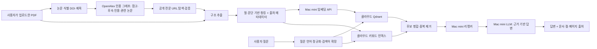

# RAG 확장 설계

상태: **확장 설계 + 수집 진단 실험**. 웹 앱은 업로드 논문의 3문장 묶음, OpenAlex의 참고·관련·후속 인용·최근 논문 초록, Wikipedia 설명을 TF-IDF로 검색한다. 별도 진단 스크립트가 OpenAlex 후보의 공개 PDF URL을 내려받고 첫 페이지 제목을 대조해 텍스트 추출까지 시험한다. 이 수집은 아직 웹 앱의 RAG 흐름에 연결되지 않았다. 구조 기반 청킹, 임베딩, 벡터 DB, 하이브리드 검색, 리랭킹도 아직 구현·검증하지 않았다.

## 데이터 흐름

## 1. 논문 식별과 외부 자료 수집

- 업로드 PDF에서 DOI를 우선 추출한다. DOI가 없으면 제목을 추출해 OpenAlex에서 찾되, 제목 유사도·저자·연도를 검증해 잘못된 논문에 연결하지 않는다.
- 업로드 논문이 참고문헌에 열거한 **모든 인용 논문**을 1단계로 수집한다. OpenAlex가 제공하는 `referenced_works` 목록 전체를 대상으로 서지 정보를 모으고 DOI/OpenAlex ID로 중복을 제거한다. 목록이 긴 논문은 API 일괄 조회와 속도 제한을 적용한다.
- 업로드 논문을 인용한 논문은 무한히 늘 수 있으므로 전체를 받지 않는다. 주제 검색과 `cites` 관계를 함께 사용해 최근성·초록 관련도를 계산한 상위 후보를 정한다. `related_works`도 후보군으로 취급하고, 검색 결과를 그대로 관련 있다고 단정하지 않는다. 초기에는 최근·관련·후속 인용 논문 각각 상위 20편 이내에서 실제 PDF 수집 품질과 처리 시간을 측정한다.
- 참고 논문과 선정된 관련·후속 인용 논문 각각에 대해 공개 전문 위치(`best_oa_location.pdf_url` 등)를 확인하고, 접근 가능한 전문을 다운로드해 인덱싱한다. 이용 조건이 허용되는 자료만 다룬다. 유료·비공개 전문에 접근을 우회하지 않는다. 전문을 얻지 못한 경우 초록은 별도 유형으로 인덱싱하고, UI와 수집 보고서에서 `전체 본문`, `초록만`, `메타데이터만`, `수집 실패`를 구분한다. 목표는 **후보 논문마다 전체 본문 확보를 시도**하는 것이며 모든 논문에서 전문을 얻을 수 있다고 보장하지 않는다.
- 수집 보고서에는 발견 수, 전문 다운로드 성공 수, 초록 대체 수, 실패 수, 청크 수를 기록한다. 각 문서의 원본 URL, 라이선스/공개 접근 상태, OpenAlex ID, DOI, 연도, 저자, 수집 시각을 보존한다. PDF 다운로드는 임시 파일로 처리하고 원본은 추출 후 삭제한다. 크기·페이지·총 다운로드량·요청 수 제한, 재시도·속도 제한, 허용된 HTTPS 도메인 검증을 둔다.
- 배경 지식은 첫 버전의 Wikipedia를 유지하되 논문 근거와 분리해 표시한다. 출처 없는 모델 지식은 RAG 자료로 취급하지 않는다.

## 2. 구조 추출과 청킹

- PDF.js는 화면 렌더링에 계속 쓰고, 인덱싱용 구조 추출은 PyMuPDF를 기준선으로 실제 PDF에서 Docling을 비교한다. 제목, 초록, 절, 문단, 표·그림 캡션, 페이지, 참고문헌을 분리한다. figure 이미지는 읽기 화면에서 원본 PDF로 보여주며, RAG에서는 우선 캡션과 주변 설명을 텍스트로 사용한다.
- 참고문헌 목록 자체와 머리글·바닥글은 일반 본문 청크에서 제외한다. 절·문단 경계에서 약 300~500 토큰씩 나누고 약 50~80 토큰을 겹치게 하는 값을 평가로 조정한다. 짧은 초록과 캡션은 독립 청크로 둔다. 수식·표를 임의로 깨지 않도록 한다.
- 업로드 논문과 접근 가능한 외부 논문 전문을 모두 본문 청킹 대상으로 삼는다. 청크마다 `paper_id`, `source_id`, `source_type`(업로드/참고/후속 인용/관련/배경), `content_scope`(전문/초록/캡션), 제목, 절, 페이지, DOI, 원본 URL, 라이선스/접근 상태, 청크 번호, 추출·임베딩 모델 버전을 붙인다. 이 메타데이터를 검색 필터와 사용자 인용 표시에 사용한다.

## 3. 벡터화와 인덱스

- LangChain은 `Document` 메타데이터, 텍스트 분할기, Qdrant 연동과 검색 파이프라인 조립에 사용한다. 수집·검증 로직은 서비스 코드에 명시적으로 두어 실패 원인과 출처를 추적한다.
- 임베딩은 아직 도입하지 않았다. 현재는 TF-IDF 기준선을 사용한다. 벡터 검색을 추가할 때 vLLM 임베딩 지원 모델 또는 별도 임베딩 서버를 평가하고, 한국어 질의와 영어 원문 검색의 성능을 비교한다. 모델명·차원·버전을 인덱스에 고정하고 변경 시 재색인한다.
- 청크 본문·벡터·출처 메타데이터를 클라우드 Docker의 Qdrant에 저장한다. 키워드 검색은 별도 BM25 인덱스(초기에는 SQLite FTS5 또는 `rank_bm25`)로 둔다. 기존 제품 범위에 맞춰 인덱스는 마지막 사용 후 24시간에 만료시키고 삭제 작업이 벡터·키워드 인덱스 양쪽에서 실행되게 한다. 단어장 데이터는 이 만료 대상에서 제외한다.

## 4. 검색, 리랭킹, 답변

- 질문을 영어 검색어로 정규화하고 업로드 논문·외부 논문을 모두 대상으로 벡터 검색과 BM25 검색을 병렬 실행한다. 자료 유형별 결과가 한쪽으로 쏠리지 않도록 후보를 합치고 중복 청크를 제거한다. 첫 실험은 각 검색기 상위 15개, 병합 20~30개를 사용한다.
- Mac mini에서 크로스 인코더 리랭커(후보: `BAAI/bge-reranker-base`)로 질문과 후보 청크의 관련성을 다시 평가하고 상위 5~8개를 LLM에 제공한다. 24GB 메모리에서 번역 LLM·임베딩·리랭커 동시 실행을 측정하고 필요하면 작업을 직렬화한다. 리랭커 서빙 방식은 Mac 실측 후 확정한다.
- LLM에는 청크 ID가 붙은 근거만 제공한다. 답변이 근거 범위를 벗어나면 부족하다고 말하게 하고, 인용 ID가 실제 제공 청크인지 검증한다. UI에는 업로드 논문/외부 논문, 전문/초록, 절·페이지, URL을 구분해 보여준다. 인용이 달렸다는 사실만으로 주장의 정확성이 보장되는 것은 아니므로 평가에서 근거 문장과 답변 내용을 대조한다.
- 업로드 시 논문 전반에서 주요 용어 최대 24개를 선별해 뜻을 준비한다. 미준비 단어는 클릭 시점에 처리한다. 현재 문장과 같은 용어가 나온 구절, TF-IDF로 찾은 관련 본문 청크만 전달한다. 외부 논문의 내용을 원 논문의 용어 뜻으로 섞지 않는다. 모델이 반환한 원문 용어를 PDF 단어에 맞춰 클릭한 단어가 포함된 범위를 찾고 저장한다.

## 5. 실행 위치와 운영

| 구성 요소 | 실행 위치 | 현재 상태 |
|---|---|---|
| PDF 화면, 로그인, 업로드 API, SQLite | 웹 서버/클라우드 후보 | 로컬 Docker 검증 완료, AWS 미배포 |
| 용어 미리 준비·클릭 뜻·질문 답변 LLM | Mac mini vLLM-Metal | 용어 API 연결; 준비 시간은 실제 Mac에서 측정 필요 |
| 외부 논문 탐색 | 웹 백엔드 → OpenAlex/Wikipedia | 참고문헌 전체 ID와 관련 후보 최대 20편을 조회; 실제 API에서 일부 ID는 metadata 미확인 |
| 공개 전문 다운로드·파싱 | 저장소 진단 스크립트 | OpenAlex OA PDF 후보 다운로드, 첫 페이지 제목 대조, PDF 텍스트 추출 시험; 웹 앱에는 미연결 |
| LangChain 청킹·인덱싱 | 클라우드 작업자 후보 | 미구현 |
| 임베딩·리랭킹 모델 | Mac mini 후보 | 미구현·메모리 미측정 |
| Qdrant + BM25 | 클라우드 | 미구현; 현재는 요청 시 TF-IDF |
| 작업 대기열 | 클라우드 | 미구현; 현재 웹 프로세스 백그라운드 작업 |

외부 논문 수집과 임베딩은 업로드 직후 오래 걸릴 수 있어 별도로 진행한다. 읽기 화면은 주요 용어 준비가 끝나면 연다. 현재 준비 작업은 웹 프로세스에서 최대 3개 용어를 동시에 처리하고 SQLite에 진행 수를 저장한다. 서버 재시작 시 중단을 표시하고 다시 시도할 수 있지만 자동 재개는 아직 없다. 운영 규모가 커지면 작업 대기열(예: Redis+RQ)을 도입한다. Mac mini가 꺼져 있으면 새 뜻과 질문 답변을 만들 수 없지만 이미 저장된 뜻은 캐시 기간 동안 조회할 수 있다.

## 6. 단계별 구현·검증

1. 실제 AI PDF 3~5편으로 PDF 파싱과 논문 식별 정확도를 측정하고, 공개 전문이 있는 참고·인용·관련 논문을 수동 정답 목록으로 만든다.
2. OpenAlex에서 모든 참고문헌과 선정된 관련·후속 인용 후보를 모은다. 후보별 공개 전문 접근을 확인하고 전체 본문 다운로드 시도, 초록 대체, 실패를 구분해 기록한다. 다운로드 수·용량 제한을 검증한다.
3. 업로드 논문과 외부 공개 전문을 파싱해 청크와 출처 메타데이터를 저장한다. 대표 문서별 앞·중간·뒤 청크와 페이지·절 정보가 원문과 맞는지 확인한다.
4. Mac mini vLLM-Metal과 임베딩 API를 사설망으로 연결하고 Qdrant/BM25 인덱스를 만든다. 현재 TF-IDF 기준선과 검색 정답률(`Recall@5/10`)을 비교한다.
5. 리랭커를 추가해 같은 질문의 검색 정답률, 답변의 근거 적합성, 응답 시간, Mac 메모리를 비교한다. 인용 오류와 근거 부족 답변을 별도로 평가한다.
6. 전체 참고문헌 처리 시간이 길어질 수 있으므로 업로드 작업을 큐로 분리하고 24시간 삭제·재시도·로그를 검증한 뒤 클라우드에 배포한다. 동시 요청과 저장 용량·비용을 측정한다.

구현 후에는 사용 모델·파라미터·평가 PDF와 질문 목록·측정 결과를 기록한다. LangChain 채택 자체보다 각 단계가 검색과 답변 품질을 얼마나 개선했는지를 포트폴리오에서 보여준다.
