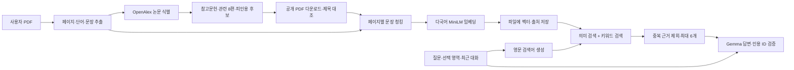

# PDF 선택·채팅·RAG 사용 및 검증

## 화면에서 사용하는 순서

1. PDF를 업로드합니다. 요약과 문헌 수집·색인이 완료되면 원문과 채팅 화면이 열립니다. 진행 기록에는 각 논문의 전문 확보 여부와 임베딩 진행 개수가 표시됩니다. `원문 먼저 열기`로 읽기를 먼저 시작할 수도 있습니다.
2. `단어 뜻`에서 단어를 클릭합니다. 한국어 뜻은 선택한 원문 영역의 중앙에 표시하며 이웃 단어 위로 확장하지 않습니다. 긴 뜻은 영역 너비에 맞춰 압축되며, 오른쪽 뜻 카드에서 전체를 읽을 수 있습니다.
3. `문장 선택`으로 단어나 문장을 드래그합니다. 선택 카드의 `채팅에 첨부`를 누르거나 카드를 오른쪽 대화 영역으로 끌어옵니다. 같은 모드에서 단어를 두 번 누르면 문장 전체를 선택합니다.
4. `그림 선택`으로 사각 영역을 드래그합니다. 미리보기를 확인해 첨부합니다. 서버는 원본 PDF의 해당 영역을 다시 잘라 OpenAI 호환 `image_url` 메시지로 보냅니다. 텍스트 설명으로 이미지를 대신하지 않습니다. vLLM의 해당 모델에 이미지 입력 지원이 켜져 있어야 합니다.
5. 질문을 입력합니다. Enter로 전송, Shift+Enter로 줄바꿈합니다. 최대 네 개의 선택 영역(그림은 두 개)을 첨부할 수 있으며 최근 대화도 전달합니다.
6. 답변의 출처 번호 또는 `출처`를 열어 문서명·페이지·문장 ID·검색 근거 원문을 확인합니다. 전문이 있으면 수집된 PDF의 해당 페이지를 열고, 초록만 있으면 외부 문서 링크를 엽니다. 근거 문장은 모델이 지어낸 인용문이 아니라 검색 결과에서 가져옵니다. 인용 ID 검증이 답변의 모든 주장에 대한 사실 검증을 대신하지는 않습니다.
7. `인용 지도`에서 전체 문헌 목록과 공개 전문 확보 상태를 확인합니다. 그래프의 화살표는 인용하는 논문에서 인용된 논문으로 향합니다. 관련도만 확인된 논문에는 인용선을 만들지 않습니다. `크게 보기`와 `문헌 다시 수집`을 사용할 수 있습니다.

## 데이터 흐름



- **수집:** OpenAlex에 등록된 전체 참고문헌 ID를 배치 조회합니다. 관련 후보는 OpenAlex 순서의 최대 8편, 피인용은 최대 5편입니다. OpenAlex에 누락된 참고문헌이나 잘못 연결된 서지는 PDF 참고문헌 전체와 다를 수 있습니다. 기존 GROBID 진단 스크립트와 별개로, 이번 웹 경로는 OpenAlex를 사용합니다. 관련 논문을 LLM으로 재선정하지는 않습니다.
- **전문:** 공개 PDF 주소를 최대 3편씩 동시에 내려받습니다. 각 PDF는 HTTPS·공개 주소·최대 25MB·100페이지·텍스트층·제목 일치 검사를 거칩니다. 실패하면 오류를 기록하고 초록만 검색하거나, 초록도 없으면 검색 색인에서 제외합니다. 유료 원문 우회, OCR, 임의의 HTML 본문 수집은 하지 않습니다.
- **청킹:** 페이지 경계를 넘지 않고 최대 110개 공백 기준 단어를 묶습니다. 긴 문장은 70개 단어 단위로 나눕니다. 여러 문장으로 구성한 청크는 마지막 문장을 다음 청크에 겹칩니다. 원문 페이지와 문장 ID를 보존합니다.
- **임베딩:** FastEmbed 0.7.4의 `sentence-transformers/paraphrase-multilingual-MiniLM-L12-v2`, 384차원입니다. 웹 서버의 CPU에서 실행하므로 번역용 Gemma 모델을 바꾸거나 Mac GPU에 다른 모델을 추가하지 않습니다. 128 모델 토큰을 초과한 청크는 토큰 창으로 나눠 모두 임베딩한 뒤 평균·정규화하므로 뒷부분을 잘라 버리지 않습니다. 최초 사용 때만 Hugging Face에서 별도 임베딩 가중치를 다운로드해 캐시합니다.
- **검색:** 정규화한 벡터의 내적과 TF-IDF 점수를 0.8:0.2로 합칩니다. 문장 ID가 많이 겹치는 결과를 제거합니다. 별도 cross-encoder 리랭커와 LangChain은 아직 사용하지 않습니다. 고정 점수 기준은 관련성에 대한 확률이나 검증된 정확도 지표가 아닙니다.
- **LLM 입력:** 최대 6개 근거(선택 영역 포함), 짧게 제한한 최근 대화, 선택한 그림만 전달합니다. 논문 전문 전체를 매 질문마다 모델에 보내지는 않습니다. 이전 답변은 대화 문맥이며 검색 근거로 취급하지 않습니다.
- **캐시 이관:** 이전 초록 검색 결과를 가진 PDF를 다시 업로드하면 새 색인을 만듭니다. 임베딩 모델 또는 색인 버전이 바뀌어도 다시 구축합니다.

## 저장 위치

로컬 기본값은 `readpaper/data/runtime/`, Docker는 기존 `readpaper-data` 볼륨의 `/data/`입니다. 이번 변경에서 기존 볼륨을 교체하거나 삭제하지 않습니다.

```text
papers/<paper_id>/
  original.pdf             업로드 원본
  sources/
    external-*.pdf         실제 수집한 PDF
    external-*.txt         추출한 전체 텍스트
    manifest.json          서지·문장·성공/실패 상태
  index/
    chunks.json            청크·페이지·문장 ID
    vectors.npy            수치 벡터 (pickle 사용 안 함)
    index.json             모델·차원·청크 수·버전
models/                    임베딩 모델 캐시
readpaper.sqlite3          논문 상태·진행 기록·단어장
```

논문은 마지막 사용 후 24시간이 지나면 DB, PDF, 본문, 색인을 함께 삭제합니다. 단어장과 공용 임베딩 모델 캐시는 유지합니다. Docker 데이터를 로컬 폴더에서 확인하려면:

```bash
docker compose cp web:/data/papers ./data/inspection/web-papers
```

컨테이너의 수집 결과를 저장소의 inspection 폴더로 복사하는 명령입니다.

## 검증

```bash
PYTHONPATH=backend ./.venv/bin/python -m unittest discover -s backend/tests -v
npm run build --prefix frontend
```

로컬과 Docker에서 47개 테스트가 통과했습니다. 자동 테스트는 네트워크·Gemma 없이 실행하며 임베딩과 답변은 결정적 테스트 대역을 사용합니다. 수집·검색의 실제 네트워크/모델 검사는 다음처럼 별도로 실행합니다.

```bash
./.venv/bin/python backend/scripts/verify_rag_pipeline.py \
  --title 'Attention Is All You Need' \
  --out data/inspection/rag-check
```

OpenAlex 검색, 공개 PDF 수집, 실제 임베딩, 한국어 검색까지 수행하고 `report.json`에 기록합니다. `--pdf data/papers/input/example.pdf`로 업로드 논문도 포함할 수 있습니다. `--reuse`는 이미 저장된 manifest에서 색인만 다시 만듭니다. 이 검사는 답변용 Gemma를 호출하지 않습니다.

### 이번 검증 결과

- 실서비스 API에서 메타데이터 36편 발견 → 관련 후보 8편 제한 후 33편 처리(참고 21, 관련 8, 피인용 4).
- 전문 확보 18편, 공개 PDF 주소 없음 9편, 다운로드·제목 검증 등 실패 6편. 일부의 실패를 전체 전문 확보 성공으로 취급하지 않았습니다.
- 외부 자료에서 2,094개 청크, 384차원 색인 생성. 실제 한국어 질문으로 영문 근거 검색 실행.
- 독립된 세 문서 검색 사례에서 한국어 쿼리·키 질문과 강화학습 보상 질문이 각각 해당 영문 문서를 1위로 검색했습니다. 이 두 사례가 일반적인 검색 정확도를 보장하지는 않습니다.
- Chromium에서 PDF 업로드, 번역 영역 넘침 방지, 문장 드래그·첨부, 채팅 출처·페이지, 그림 크롭·첨부, 그래프, 390px 화면 가로 넘침을 확인했습니다. 채팅 응답은 테스트 대역입니다.
- 현재 클라우드에서 Mac mini의 vLLM에 직접 연결되지 않아 실제 Gemma 답변 품질과 이미지 추론은 아직 검증하지 못했습니다.

검증 생성물은 `data/inspection/rag-live-check/`, 화면 캡처는 `data/inspection/ui-check/`에 있으며 Git에는 포함하지 않습니다.

브라우저 검사를 재실행하려면 개발 환경에서 Playwright를 설치하고 프론트엔드를 빌드합니다. 아래 검사는 임시 데이터베이스와 임의의 로컬 포트에 테스트 서버를 띄우고 종료하므로 실제 서비스 데이터나 모델을 사용하지 않습니다.
Playwright 브라우저가 없으면 시스템의 `chromium` 또는 `chromium-browser`를 사용합니다. 다른 실행 파일을 쓰려면 `READPAPER_CHROMIUM_PATH`를 지정합니다.

```bash
./.venv/bin/pip install playwright
./.venv/bin/python -m playwright install chromium
npm run build --prefix frontend
./.venv/bin/python backend/scripts/check_workspace_ui.py
```
